# Blueprint map

<!-- Generated by `python scripts/blueprint.py map` from the annotations in
     paper/main.tex and the declarations in ShortTime/. Do not edit by hand. -->

Every node is a numbered item of the [companion paper](../paper/main.pdf). Arrows point from an item to the items it depends on. Colours give the formalization status.

| Status | Meaning | Count |
|---|---|---|
| `proved` | proved (no `sorry`) | 29 |
| `defined` | definition written in Lean | 9 |
| `partial` | some Lean declarations exist | 4 |
| `planned` | Lean name reserved, not yet stated | 2 |
| `imported` | imported fact (Mathlib / library) | 6 |

```mermaid
flowchart BT
  subgraph L1_Setting___algebra["L1 Setting & algebra"]
    lem_ricci["lem:ricci<br/><small>commuting covariant derivatives</small>"]
    def_jet["def:jet<br/><small>covariant jets</small>"]
    def_data["def:data<br/><small>equation data</small>"]
    def_solution["def:solution<br/><small>Definition</small>"]
    def_linearization["def:linearization<br/><small>linearization</small>"]
    def_legendre["def:legendre<br/><small>Legendre condition</small>"]
    lem_legendre_basic["lem:legendre-basic<br/><small>Lemma</small>"]
    lem_legendre_examples["lem:legendre-examples<br/><small>examples</small>"]
    thm_A["thm:A<br/><small>existence and regularity</small>"]
    thm_B["thm:B<br/><small>uniqueness</small>"]
    thm_C["thm:C<br/><small>smooth dependence</small>"]
    cor_C["cor:C<br/><small>continuous dependence, sequential form</small>"]
    cor_maximal["cor:maximal<br/><small>maximal solutions</small>"]
    cor_MM["cor:MM<br/><small>Mantegazza–Martinazzi</small>"]
  end
  subgraph L2_Function_spaces["L2 Function spaces"]
    def_sobolev["def:sobolev<br/><small>Definition</small>"]
    lem_sobolev_basic["lem:sobolev-basic<br/><small>Lemma</small>"]
    lem_interp["lem:interp<br/><small>interpolation</small>"]
    lem_ricci_l2["lem:ricci-l2<br/><small>permuting derivatives in $L^2$</small>"]
    fact_sobolev["fact:sobolev<br/><small>Sobolev embedding</small>"]
    fact_weak["fact:weak<br/><small>weak and strong derivatives</small>"]
    def_parabolic["def:parabolic<br/><small>Definition</small>"]
    lem_parabolic_basic["lem:parabolic-basic<br/><small>Lemma</small>"]
    lem_embedding["lem:embedding<br/><small>embedding</small>"]
    prop_nemytskii["prop:nemytskii<br/><small>algebra and composition</small>"]
    cor_N["cor:N<br/><small>the nonlinear operator</small>"]
    lem_spatial_nemytskii["lem:spatial-nemytskii<br/><small>spatial composition</small>"]
    fact_eigen["fact:eigen<br/><small>eigenbasis</small>"]
    fact_elliptic["fact:elliptic<br/><small>elliptic estimate</small>"]
  end
  subgraph L3_Linear_theory["L3 Linear theory"]
    def_class["def:class<br/><small>Definition</small>"]
    def_flip["def:flip<br/><small>flip of a coefficient</small>"]
    lem_ibp_one["lem:ibp-one<br/><small>one integration by parts</small>"]
    lem_ibp["lem:ibp<br/><small>integration by parts in the principal term</small>"]
    lem_garding["lem:garding<br/><small>Gårding's inequality</small>"]
    lem_commute["lem:commute<br/><small>differentiating an operator</small>"]
    prop_energy["prop:energy<br/><small>energy estimates</small>"]
    prop_apriori["prop:apriori<br/><small>a priori estimate</small>"]
    prop_model["prop:model<br/><small>Proposition</small>"]
    lem_continuity["lem:continuity<br/><small>method of continuity</small>"]
    thm_linear["thm:linear<br/><small>linear parabolic theory</small>"]
  end
  subgraph L4_Nonlinear_theory["L4 Nonlinear theory"]
    lem_formal["lem:formal<br/><small>formal solution</small>"]
    lem_cutoff["lem:cutoff<br/><small>cutoff</small>"]
    prop_existence["prop:existence<br/><small>Proposition</small>"]
    lem_flows["lem:flows<br/><small>Lemma</small>"]
    prop_regularity["prop:regularity<br/><small>regularity</small>"]
    lem_lowering["lem:lowering<br/><small>lowering indices</small>"]
    lem_difference["lem:difference<br/><small>the difference of two solutions</small>"]
    lem_legendre_coord["lem:legendre-coord<br/><small>the Legendre form in coordinates</small>"]
    lem_local_unique["lem:local-unique<br/><small>local uniqueness</small>"]
  end
  subgraph Tools["Tools"]
    fact_ift["fact:ift<br/><small>implicit function theorem</small>"]
    fact_gronwall["fact:gronwall<br/><small>Gronwall</small>"]
  end
  def_data --> def_jet
  def_solution --> def_data
  def_solution --> def_jet
  def_linearization --> def_data
  def_legendre --> def_linearization
  lem_legendre_basic --> def_legendre
  lem_legendre_examples --> def_legendre
  lem_legendre_examples --> lem_ricci
  thm_A --> def_solution
  thm_A --> def_legendre
  thm_A --> prop_existence
  thm_A --> prop_regularity
  thm_A --> lem_lowering
  thm_B --> def_solution
  thm_B --> def_legendre
  thm_B --> lem_lowering
  thm_B --> lem_local_unique
  thm_C --> def_solution
  thm_C --> def_legendre
  thm_C --> def_sobolev
  thm_C --> def_parabolic
  thm_C --> thm_linear
  thm_C --> cor_N
  thm_C --> fact_ift
  thm_C --> lem_flows
  thm_C --> prop_regularity
  thm_C --> lem_parabolic_basic
  cor_C --> def_solution
  cor_C --> def_legendre
  cor_C --> thm_C
  cor_C --> thm_B
  cor_C --> lem_embedding
  cor_maximal --> def_solution
  cor_maximal --> thm_A
  cor_maximal --> thm_B
  cor_MM --> def_solution
  cor_MM --> thm_A
  cor_MM --> thm_B
  cor_MM --> cor_C
  cor_MM --> lem_legendre_examples
  cor_MM --> lem_ricci
  lem_sobolev_basic --> def_sobolev
  lem_interp --> def_sobolev
  lem_ricci_l2 --> def_sobolev
  fact_sobolev --> def_sobolev
  fact_weak --> def_sobolev
  def_parabolic --> def_sobolev
  lem_parabolic_basic --> def_parabolic
  lem_parabolic_basic --> lem_sobolev_basic
  lem_embedding --> lem_parabolic_basic
  lem_embedding --> fact_sobolev
  prop_nemytskii --> def_parabolic
  prop_nemytskii --> lem_embedding
  cor_N --> def_data
  cor_N --> def_linearization
  cor_N --> def_parabolic
  cor_N --> prop_nemytskii
  cor_N --> lem_parabolic_basic
  lem_spatial_nemytskii --> def_data
  lem_spatial_nemytskii --> def_sobolev
  lem_spatial_nemytskii --> fact_sobolev
  fact_elliptic --> def_sobolev
  def_class --> def_legendre
  lem_ibp_one --> def_flip
  lem_ibp --> def_legendre
  lem_ibp --> def_sobolev
  lem_ibp --> lem_ibp_one
  lem_ibp --> lem_ricci_l2
  lem_garding --> def_class
  lem_garding --> def_sobolev
  lem_garding --> lem_ibp
  lem_garding --> lem_interp
  lem_commute --> def_class
  lem_commute --> lem_ricci
  lem_commute --> lem_legendre_basic
  prop_energy --> def_class
  prop_energy --> def_sobolev
  prop_energy --> lem_garding
  prop_energy --> lem_commute
  prop_energy --> lem_sobolev_basic
  prop_energy --> fact_gronwall
  prop_apriori --> def_class
  prop_apriori --> def_parabolic
  prop_apriori --> prop_energy
  prop_apriori --> lem_parabolic_basic
  prop_apriori --> lem_sobolev_basic
  prop_model --> def_class
  prop_model --> def_parabolic
  prop_model --> lem_legendre_examples
  prop_model --> fact_eigen
  prop_model --> fact_elliptic
  prop_model --> prop_apriori
  thm_linear --> def_class
  thm_linear --> def_parabolic
  thm_linear --> prop_model
  thm_linear --> prop_apriori
  thm_linear --> lem_continuity
  thm_linear --> lem_legendre_basic
  thm_linear --> lem_embedding
  thm_linear --> lem_garding
  lem_formal --> def_data
  lem_cutoff --> def_parabolic
  prop_existence --> def_data
  prop_existence --> def_parabolic
  prop_existence --> def_legendre
  prop_existence --> lem_formal
  prop_existence --> lem_cutoff
  prop_existence --> cor_N
  prop_existence --> thm_linear
  prop_existence --> fact_ift
  prop_existence --> lem_embedding
  prop_existence --> lem_parabolic_basic
  prop_existence --> lem_legendre_basic
  lem_flows --> def_data
  lem_flows --> def_parabolic
  lem_flows --> fact_weak
  prop_regularity --> prop_existence
  prop_regularity --> def_solution
  prop_regularity --> lem_flows
  prop_regularity --> fact_ift
  prop_regularity --> fact_weak
  prop_regularity --> lem_spatial_nemytskii
  prop_regularity --> cor_N
  prop_regularity --> fact_sobolev
  prop_regularity --> lem_parabolic_basic
  lem_lowering --> def_data
  lem_lowering --> def_solution
  lem_lowering --> def_legendre
  lem_difference --> def_data
  lem_difference --> def_solution
  lem_difference --> def_linearization
  lem_difference --> def_legendre
  lem_difference --> def_class
  lem_legendre_coord --> def_legendre
  lem_legendre_coord --> lem_ibp
  lem_local_unique --> def_solution
  lem_local_unique --> def_legendre
  lem_local_unique --> def_class
  lem_local_unique --> lem_difference
  lem_local_unique --> lem_garding
  lem_local_unique --> lem_legendre_coord
  lem_local_unique --> fact_gronwall
  classDef proved fill:#1f8a4c,color:#fff,stroke:#146236
  class lem_ricci,lem_legendre_examples,thm_A,thm_B,cor_C,cor_maximal,cor_MM,lem_interp,lem_ricci_l2,lem_embedding,cor_N,lem_ibp_one,lem_ibp,lem_garding,lem_commute,prop_energy,prop_apriori,prop_model,lem_continuity,thm_linear,lem_formal,lem_cutoff,prop_existence,lem_flows,prop_regularity,lem_lowering,lem_difference,lem_legendre_coord,lem_local_unique proved
  classDef defined fill:#b7e1c5,color:#123,stroke:#4c9a68
  class def_jet,def_data,def_solution,def_linearization,def_legendre,def_sobolev,def_parabolic,def_class,def_flip defined
  classDef partial fill:#f7dd9b,color:#222,stroke:#b8902e
  class lem_legendre_basic,lem_sobolev_basic,lem_parabolic_basic,prop_nemytskii partial
  classDef planned fill:#eeeeee,color:#333,stroke:#999
  class thm_C,lem_spatial_nemytskii planned
  classDef imported fill:#dbe8f6,color:#1c3a5e,stroke:#6b8fb8
  class fact_sobolev,fact_weak,fact_eigen,fact_elliptic,fact_ift,fact_gronwall imported
```

## L1 Setting & algebra

| Item | Kind | Lean | Depends on | Status |
|---|---|---|---|---|
| lem:ricci *commuting covariant derivatives* | lemma | `ShortTime.permute_iteratedCovGrad` ([src](../ShortTime/Linear/Commute.lean)) |  | `proved` |
| def:jet *covariant jets* | definition | `ShortTime.CovJetFiber` ([src](../ShortTime/Setting/Jet.lean)) `ShortTime.covJet` ([src](../ShortTime/Setting/Jet.lean)) |  | `defined` |
| def:data *equation data* | definition | `ShortTime.EquationData` ([src](../ShortTime/Setting/Equation.lean)) `ShortTime.localDom` ([src](../ShortTime/Setting/Equation.lean)) `ShortTime.localRep` ([src](../ShortTime/Setting/Equation.lean)) | `def:jet` | `defined` |
| def:solution | definition | `ShortTime.JointlySmoothOn` ([src](../ShortTime/Setting/Jet.lean)) `ShortTime.EquationData.IsSolution` ([src](../ShortTime/Setting/Equation.lean)) `ShortTime.EquationData.IsParabolicSolution` ([src](../ShortTime/Setting/Equation.lean)) | `def:data`, `def:jet` | `defined` |
| def:linearization *linearization* | definition | `ShortTime.EquationData.partialDeriv` ([src](../ShortTime/Setting/Equation.lean)) `ShortTime.EquationData.principal` ([src](../ShortTime/Setting/Equation.lean)) | `def:data` | `defined` |
| def:legendre *Legendre condition* | definition | `ShortTime.legendreForm` ([src](../ShortTime/Setting/Legendre.lean)) `ShortTime.LegendreAt` ([src](../ShortTime/Setting/Legendre.lean)) `ShortTime.EquationData.IsParabolicAt` ([src](../ShortTime/Setting/Equation.lean)) | `def:linearization` | `defined` |
| lem:legendre-basic | lemma | `ShortTime.legendreForm_add` ([src](../ShortTime/Setting/LegendreBasic.lean)) `ShortTime.legendreForm_smul` ([src](../ShortTime/Setting/LegendreBasic.lean)) `ShortTime.LegendreAt.combo` ([src](../ShortTime/Setting/LegendreBasic.lean)) `ShortTime.isOpen_parabolicDomain` `ShortTime.legendre_tube` | `def:legendre` | `partial` |
| lem:legendre-examples *examples* | lemma | `ShortTime.legendre_product` ([src](../ShortTime/Sanity/LegendreProduct.lean)) `ShortTime.isDiffOp_lapIter_sub_modelTop` ([src](../ShortTime/Linear/ModelOp.lean)) `ShortTime.legendreAt_modelTop` ([src](../ShortTime/Linear/ModelOp.lean)) `ShortTime.polyTrace` ([src](../ShortTime/Sanity/PolyTrace.lean)) `ShortTime.legendreAt_polyTrace` ([src](../ShortTime/Sanity/PolyTrace.lean)) `ShortTime.productCLM` ([src](../ShortTime/Sanity/LegendreProduct.lean)) `ShortTime.mmPairing` ([src](../ShortTime/MM/PairingDef.lean)) | `def:legendre`, `lem:ricci` | `proved` |
| thm:A *existence and regularity* | theorem | `ShortTime.exists_solution` ([src](../ShortTime/MainTheorems.lean)) | `def:solution`, `def:legendre`, `prop:existence`, `prop:regularity`, `lem:lowering` | `proved` |
| thm:B *uniqueness* | theorem | `ShortTime.solution_unique` ([src](../ShortTime/MainTheorems.lean)) `ShortTime.EquationData.solution_unique_cov` ([src](../ShortTime/Nonlinear/UniquenessB.lean)) | `def:solution`, `def:legendre`, `lem:lowering`, `lem:local-unique` | `proved` |
| thm:C *smooth dependence* | theorem | `ShortTime.solution_smooth_dependence` | `def:solution`, `def:legendre`, `def:sobolev`, `def:parabolic`, `thm:linear`, `cor:N`, `fact:ift`, `lem:flows`, `prop:regularity`, `lem:parabolic-basic` | `planned` |
| cor:C *continuous dependence, sequential form* | corollary | `ShortTime.solution_continuous_dependence` ([src](../ShortTime/MainTheorems.lean)) `ShortTime.solution_continuous_dependence'` ([src](../ShortTime/Nonlinear/ContinuousDependenceMain.lean)) `ShortTime.solution_continuous_dependence_of_covariant` ([src](../ShortTime/Nonlinear/ContinuousDependenceLower.lean)) `ShortTime.EquationData.continuous_dependence_cov` ([src](../ShortTime/Nonlinear/ContinuousDependenceCov.lean)) `ShortTime.EquationData.traceRegularity` ([src](../ShortTime/Nonlinear/RegularityTraceFinal.lean)) `ShortTime.EquationData.smoothRep_time_trace` ([src](../ShortTime/Nonlinear/SmoothRepTimeTrace.lean)) | `def:solution`, `def:legendre`, `thm:C`, `thm:B`, `lem:embedding` | `proved` |
| cor:maximal *maximal solutions* | corollary | `ShortTime.exists_maximal_solution` ([src](../ShortTime/Maximal.lean)) `ShortTime.EquationData.isParabolicSolution_of_le` ([src](../ShortTime/Maximal.lean)) | `def:solution`, `thm:A`, `thm:B` | `proved` |
| cor:MM *Mantegazza–Martinazzi* | corollary | `ShortTime.mantegazza_martinazzi` ([src](../ShortTime/MM/Main.lean)) `ShortTime.MMData` ([src](../ShortTime/MM/Data.lean)) `ShortTime.MMData.F` ([src](../ShortTime/MM/Data.lean)) `ShortTime.MMData.toEquationData` ([src](../ShortTime/MM/Rearranged.lean)) `ShortTime.MMData.rearranged` ([src](../ShortTime/MM/Rearranged.lean)) `ShortTime.MMData.rearranged_isSolution_iff` ([src](../ShortTime/MM/Rearranged.lean)) `ShortTime.MMData.rearranged_isParabolicAt` ([src](../ShortTime/MM/Rearranged.lean)) `ShortTime.MMData.isParabolicSolution_rearranged` ([src](../ShortTime/MM/Main.lean)) `ShortTime.exists_ricci_jetMap` ([src](../ShortTime/Nonlinear/RicciJetSmooth.lean)) `ShortTime.mmPairing_eq_productCLM_add` ([src](../ShortTime/MM/PairingRel.lean)) | `def:solution`, `thm:A`, `thm:B`, `cor:C`, `lem:legendre-examples`, `lem:ricci` | `proved` |

## L2 Function spaces

| Item | Kind | Lean | Depends on | Status |
|---|---|---|---|---|
| def:sobolev | definition | `ShortTime.sobolevNormSq` ([src](../ShortTime/Linear/Basic.lean)) `ShortTime.negSobolevNorm` ([src](../ShortTime/Linear/Basic.lean)) `ShortTime.hNormSq` ([src](../ShortTime/Linear/Basic.lean)) |  | `defined` |
| lem:sobolev-basic | lemma | `ShortTime.sobolevNormSq_succ` ([src](../ShortTime/Linear/SobolevBasic.lean)) `ShortTime.inner_le_negSobolevNorm` ([src](../ShortTime/Linear/SobolevBasic.lean)) `ShortTime.exists_negSobolevNorm_covGrad_le` ([src](../ShortTime/Linear/SobolevBasic.lean)) `ShortTime.exists_sobolevNormSq_opField_le` ([src](../ShortTime/Linear/SobolevBasic.lean)) `ShortTime.exists_negSobolevNorm_opField_covGrad_le` ([src](../ShortTime/Linear/NegSobolev.lean)) `ShortTime.sobolevNorm_diffOp_le` | `def:sobolev` | `partial` |
| lem:interp *interpolation* | lemma | `ShortTime.jetNorm_le_interp` ([src](../ShortTime/Linear/Interp.lean)) `ShortTime.exists_jetSum_pred_le` ([src](../ShortTime/Linear/Garding.lean)) `ShortTime.exists_sobolevNormSq_pred_le` ([src](../ShortTime/Linear/Garding.lean)) `ShortTime.exists_sobolevNormSq_le` ([src](../ShortTime/Linear/Garding.lean)) | `def:sobolev` | `proved` |
| lem:ricci-l2 *permuting derivatives in $L^2$* | lemma | `ShortTime.exists_perm_bound` ([src](../ShortTime/Linear/RicciEstimate.lean)) `ShortTime.exists_swap_defect` ([src](../ShortTime/Linear/RicciSwap.lean)) `ShortTime.toModel_iteratedCovGrad_domDomCongr` ([src](../ShortTime/Linear/RicciPerm.lean)) | `def:sobolev` | `proved` |
| fact:sobolev *Sobolev embedding* | fact | *DG: Analysis/Sobolev/Embedding/Tensor (spectral norms; needs norm equivalence)* | `def:sobolev` | `imported` |
| fact:weak *weak and strong derivatives* | fact | *DG: Analysis/Sobolev/Intrinsic (to check)* | `def:sobolev` | `imported` |
| def:parabolic | definition | `ShortTime.ParabolicSpace` ([src](../ShortTime/Linear/Parabolic.lean)) `ShortTime.ParabolicSpace.zeroAtStart` ([src](../ShortTime/Linear/Parabolic.lean)) | `def:sobolev` | `defined` |
| lem:parabolic-basic | lemma | `ShortTime.ParabolicSpace.timeDeriv` `ShortTime.ParabolicSpace.jet` `ShortTime.ParabolicSpace.constExt` `ShortTime.ParabolicSpace.evalJet` ([src](../ShortTime/Nonlinear/Evaluation.lean)) `ShortTime.ParabolicSpace.evalJet_ofSmooth` ([src](../ShortTime/Nonlinear/Evaluation.lean)) `ShortTime.ParabolicSpace.continuousOn_evalJet_bundle` ([src](../ShortTime/Nonlinear/Evaluation.lean)) `ShortTime.ParabolicSpace.evalJet_eq_zero_of_mem_zeroAtStart` ([src](../ShortTime/Nonlinear/Evaluation.lean)) `ShortTime.ParabolicSpace.eq_zero_of_ofSmooth_eq_zero` ([src](../ShortTime/Nonlinear/Evaluation.lean)) `ShortTime.ParabolicSpace.levelIncl` ([src](../ShortTime/Nonlinear/Evaluation.lean)) `ShortTime.ParabolicSpace.evalJet_levelIncl` ([src](../ShortTime/Nonlinear/Evaluation.lean)) `ShortTime.sobolevNormSq_le_integral` ([src](../ShortTime/Linear/Embedding.lean)) `ShortTime.sobolevNormSq_timeDerivIter_le_parabolicInner` ([src](../ShortTime/Linear/Embedding.lean)) `ShortTime.parabolicInner_iteratedCovGrad_le` ([src](../ShortTime/Nonlinear/ParabolicBound.lean)) `ShortTime.parabolicInner_timeDeriv_le` ([src](../ShortTime/Nonlinear/ParabolicBound.lean)) | `def:parabolic`, `lem:sobolev-basic` | `partial` |
| lem:embedding *embedding* | lemma | `ShortTime.exists_fiberNormSq_le_parabolicInner` ([src](../ShortTime/Linear/Embedding.lean)) `ShortTime.good_of_parabolic` ([src](../ShortTime/Linear/SmoothSolve.lean)) `ShortTime.rawJoint_limSec` ([src](../ShortTime/Linear/LimitFamily.lean)) `ShortTime.jointlySmoothOn_limFam` ([src](../ShortTime/Linear/LimitFamily.lean)) `ShortTime.jet_limFam` ([src](../ShortTime/Linear/LimitFamily.lean)) `ShortTime.contDiffOn_limChart` ([src](../ShortTime/Linear/LimitSmooth.lean)) `ShortTime.ParabolicSpace.eq_zero_of_evalJet_eq_zero` ([src](../ShortTime/Nonlinear/Closable.lean)) `ShortTime.ParabolicSpace.eq_ofSmooth_of_evalJet_eq` ([src](../ShortTime/Nonlinear/Closable.lean)) | `lem:parabolic-basic`, `fact:sobolev` | `proved` |
| prop:nemytskii *algebra and composition* | proposition | `ShortTime.ParabolicSpace.bilinear_le` `ShortTime.ParabolicSpace.contDiff_comp` `ShortTime.FaaDiBruno.exists_tame_bound_graph` ([src](../ShortTime/Analysis/FaaDiBruno.lean)) `ShortTime.FibreMap` ([src](../ShortTime/Nonlinear/FibreMap.lean)) `ShortTime.FibreMap.exists_tame_pointwise` ([src](../ShortTime/Nonlinear/FibreMapTame.lean)) `ShortTime.parabolicInner_le_of_jetSq_le` ([src](../ShortTime/Nonlinear/ParabolicBound.lean)) `ShortTime.exists_jetSq_le_parabolicInner` ([src](../ShortTime/Nonlinear/ParabolicBound.lean)) `ShortTime.SmoothExtension.exists_contDiffOn_extension` ([src](../ShortTime/Analysis/SmoothExtension.lean)) `ShortTime.FibreMap.fibreDeriv` ([src](../ShortTime/Nonlinear/FibreCalc.lean)) `ShortTime.FibreMap.taylorMap` ([src](../ShortTime/Nonlinear/FibreCalcTaylor.lean)) `ShortTime.FibreMap.exists_block_bound` ([src](../ShortTime/Nonlinear/FibreCalcBound.lean)) `ShortTime.FibreMap.exists_derivFam_bound` ([src](../ShortTime/Nonlinear/FibreCalcBound.lean)) `ShortTime.FibreMap.exists_taylor_bound` ([src](../ShortTime/Nonlinear/FibreCalcRemainder.lean)) | `def:parabolic`, `lem:embedding` | `partial` |
| cor:N *the nonlinear operator* | corollary | `ShortTime.EquationData.exists_nonlinOp` ([src](../ShortTime/Nonlinear/Nemytskii.lean)) `ShortTime.EquationData.exists_nonlinOp_aux` ([src](../ShortTime/Nonlinear/Nemytskii.lean)) `ShortTime.EquationData.exists_dom_tube` ([src](../ShortTime/Nonlinear/NemytskiiTube.lean)) `ShortTime.FibreMap.exists_nonlinOp_param` ([src](../ShortTime/Nonlinear/NemytskiiParamOp.lean)) `ShortTime.FibreMap.paramLift` ([src](../ShortTime/Nonlinear/NemytskiiParamFibre.lean)) `ShortTime.FibreMap.exists_nonlinOp_param_ball` ([src](../ShortTime/Nonlinear/UniformTubeParam.lean)) | `def:data`, `def:linearization`, `def:parabolic`, `prop:nemytskii`, `lem:parabolic-basic` | `proved` |
| lem:spatial-nemytskii *spatial composition* | lemma | `ShortTime.EquationData.contDiff_spatialOp` | `def:data`, `def:sobolev`, `fact:sobolev` | `planned` |
| fact:eigen *eigenbasis* | fact | *DG: Analysis/Spectral/Tensor (TensorEigenIdx; tensor bundles)* |  | `imported` |
| fact:elliptic *elliptic estimate* | fact | *DG: Analysis/Spectral/Tensor/SobolevScale/Jet/Bounds/IteratedCovariantDerivative (hsJet\_le, hs\_le\_jet; covariant tensors of every rank)* | `def:sobolev` | `imported` |

## L3 Linear theory

| Item | Kind | Lean | Depends on | Status |
|---|---|---|---|---|
| def:class | definition | `ShortTime.LinearOp` ([src](../ShortTime/Linear/Operator.lean)) `ShortTime.LinearOp.apply` ([src](../ShortTime/Linear/Operator.lean)) `ShortTime.LinearOp.Solves` ([src](../ShortTime/Linear/Operator.lean)) `ShortTime.LinearOp.IsParabolic` ([src](../ShortTime/Linear/Operator.lean)) | `def:legendre` | `defined` |
| def:flip *flip of a coefficient* | definition | `ShortTime.flipField` ([src](../ShortTime/Linear/Flip.lean)) `ShortTime.flipRemainder` ([src](../ShortTime/Linear/PrincipalIBP.lean)) |  | `defined` |
| lem:ibp-one *one integration by parts* | lemma | `ShortTime.inner_apply_covGrad` ([src](../ShortTime/Linear/PrincipalIBP.lean)) `ShortTime.cometricDoubleTraceFib_comp_slotExtend_flipFib` ([src](../ShortTime/Linear/Flip.lean)) `ShortTime.covDivergence_eq_trace_covGrad` ([src](../ShortTime/Linear/Divergence.lean)) | `def:flip` | `proved` |
| lem:ibp *integration by parts in the principal term* | lemma | `ShortTime.principal_ibp` ([src](../ShortTime/Linear/Garding.lean)) `ShortTime.principal_iter` ([src](../ShortTime/Linear/PrincipalIter.lean)) `ShortTime.evalFirst_flipIter` ([src](../ShortTime/Linear/LegendreGeneral.lean)) `ShortTime.legendreForm_eq_fiberInner_flipIter` ([src](../ShortTime/Linear/LegendreGeneral.lean)) | `def:legendre`, `def:sobolev`, `lem:ibp-one`, `lem:ricci-l2` | `proved` |
| lem:garding *Gårding's inequality* | lemma | `ShortTime.LinearOp.garding` ([src](../ShortTime/Linear/Garding.lean)) `ShortTime.LinearOp.garding_top` ([src](../ShortTime/Linear/Garding.lean)) `ShortTime.LinearOp.coercive` ([src](../ShortTime/Linear/Garding.lean)) | `def:class`, `def:sobolev`, `lem:ibp`, `lem:interp` | `proved` |
| lem:commute *differentiating an operator* | lemma | `ShortTime.LinearOp.exists_covGrad_comm` ([src](../ShortTime/Linear/Commute.lean)) `ShortTime.LinearOp.isParabolic_comm` ([src](../ShortTime/Linear/LegendreComm.lean)) `ShortTime.LinearOp.legendreForm_comm` ([src](../ShortTime/Linear/LegendreComm.lean)) `ShortTime.isDiffOp_cycle_defect` ([src](../ShortTime/Linear/Commute.lean)) `ShortTime.IsDiffOp.split` ([src](../ShortTime/Linear/DiffOp.lean)) | `def:class`, `lem:ricci`, `lem:legendre-basic` | `proved` |
| prop:energy *energy estimates* | proposition | `ShortTime.energy_estimate` ([src](../ShortTime/Linear/EnergyHigher.lean)) `ShortTime.LinearOp.energy_estimate_zero_of_garding` ([src](../ShortTime/Linear/EnergyEstimate.lean)) `ShortTime.LinearOp.garding_lerp` ([src](../ShortTime/Linear/EnergyHigher.lean)) `ShortTime.hasDerivWithinAt_covGrad` ([src](../ShortTime/Linear/EnergyHigher.lean)) `ShortTime.energy_ode` ([src](../ShortTime/Analysis/EnergyODE.lean)) | `def:class`, `def:sobolev`, `lem:garding`, `lem:commute`, `lem:sobolev-basic`, `fact:gronwall` | `proved` |
| prop:apriori *a priori estimate* | proposition | `ShortTime.apriori_estimate` ([src](../ShortTime/Linear/Apriori.lean)) `ShortTime.parabolicInner_self_eq` ([src](../ShortTime/Linear/Apriori.lean)) `ShortTime.LinearOp.exists_sobolevNormSq_timeDerivIter_apply_le` ([src](../ShortTime/Linear/TimeCalc.lean)) `ShortTime.timeDerivIter_iteratedCovGrad` ([src](../ShortTime/Linear/TimeCalc.lean)) | `def:class`, `def:parabolic`, `prop:energy`, `lem:parabolic-basic`, `lem:sobolev-basic` | `proved` |
| prop:model | proposition | `ShortTime.LinearOp.exists_model` ([src](../ShortTime/Linear/ModelSolve.lean)) `ShortTime.exists_polyharmonic` ([src](../ShortTime/Linear/ModelOp.lean)) `ShortTime.LinearOp.exists_solution_proj` ([src](../ShortTime/Linear/ModelSolve.lean)) `ShortTime.LinearOp.approx_of_eigen` ([src](../ShortTime/Linear/ModelSolve.lean)) `ShortTime.tendsto_integral_proj_sub` ([src](../ShortTime/Linear/ModelSpectral.lean)) `ShortTime.LinearOp.surjective_heatExt_of_approx` ([src](../ShortTime/Linear/LinearTheorem.lean)) | `def:class`, `def:parabolic`, `lem:legendre-examples`, `fact:eigen`, `fact:elliptic`, `prop:apriori` | `proved` |
| lem:continuity *method of continuity* | lemma | `ShortTime.surjective_of_continuity` ([src](../ShortTime/Linear/Continuity.lean)) |  | `proved` |
| thm:linear *linear parabolic theory* | theorem | `ShortTime.LinearOp.exists_smooth` ([src](../ShortTime/Linear/SmoothSolve.lean)) `ShortTime.LinearOp.unique_of_isParabolic` ([src](../ShortTime/Linear/Garding.lean)) `ShortTime.LinearOp.isomorphism` ([src](../ShortTime/Linear/ModelSolve.lean)) `ShortTime.LinearOp.isomorphism_of_base` ([src](../ShortTime/Linear/LinearTheorem.lean)) `ShortTime.LinearOp.heatExt` ([src](../ShortTime/Linear/LinearTheorem.lean)) `ShortTime.LinearOp.norm_le_heatExt_lerp` ([src](../ShortTime/Linear/LinearTheorem.lean)) `ShortTime.LinearOp.exists_approx` ([src](../ShortTime/Linear/SmoothSolve.lean)) `ShortTime.LinearOp.exists_smooth_zero` ([src](../ShortTime/Linear/SmoothSolve.lean)) | `def:class`, `def:parabolic`, `prop:model`, `prop:apriori`, `lem:continuity`, `lem:legendre-basic`, `lem:embedding`, `lem:garding` | `proved` |

## L4 Nonlinear theory

| Item | Kind | Lean | Depends on | Status |
|---|---|---|---|---|
| lem:formal *formal solution* | lemma | `ShortTime.EquationData.formalCoeff` ([src](../ShortTime/Nonlinear/Formal.lean)) `ShortTime.EquationData.formalCoeff_spec` ([src](../ShortTime/Nonlinear/Formal.lean)) `ShortTime.EquationData.formalCoeff_spec'` ([src](../ShortTime/Nonlinear/Formal.lean)) `ShortTime.EquationData.formalPoly` ([src](../ShortTime/Nonlinear/Formal.lean)) `ShortTime.EquationData.timeDerivIter_formalPoly` ([src](../ShortTime/Nonlinear/Formal.lean)) `ShortTime.EquationData.exists_formalPoly_dom` ([src](../ShortTime/Nonlinear/Formal.lean)) `ShortTime.EquationData.timeDerivIter_nonlinFamily_congr` ([src](../ShortTime/Nonlinear/Formal.lean)) | `def:data` | `proved` |
| lem:cutoff *cutoff* | lemma | `ShortTime.ParabolicSpace.tendsto_cutoff` ([src](../ShortTime/Nonlinear/Cutoff.lean)) `ShortTime.cutoffFamily` ([src](../ShortTime/Nonlinear/Cutoff.lean)) `ShortTime.jointlySmoothOn_cutoffFamily` ([src](../ShortTime/Nonlinear/Cutoff.lean)) `ShortTime.cutoffFamily_eq_zero` ([src](../ShortTime/Nonlinear/Cutoff.lean)) `ShortTime.tendsto_parabolicInner_cutoff` ([src](../ShortTime/Nonlinear/Cutoff.lean)) | `def:parabolic` | `proved` |
| prop:existence | proposition | `ShortTime.EquationData.exists_parabolicSpace_solution` ([src](../ShortTime/Nonlinear/Existence.lean)) `ShortTime.exists_injOn_and_image_mem_nhds` ([src](../ShortTime/Nonlinear/Existence.lean)) `ShortTime.ParabolicSpace.timeDerivExt` ([src](../ShortTime/Nonlinear/Existence.lean)) `ShortTime.ParabolicSpace.existenceMap` ([src](../ShortTime/Nonlinear/Existence.lean)) `ShortTime.LinearOp.isomorphism_eq_heatExt` ([src](../ShortTime/Nonlinear/Existence.lean)) `ShortTime.EquationData.exists_legendre_interval` ([src](../ShortTime/Nonlinear/ExistenceTube.lean)) | `def:data`, `def:parabolic`, `def:legendre`, `lem:formal`, `lem:cutoff`, `cor:N`, `thm:linear`, `fact:ift`, `lem:embedding`, `lem:parabolic-basic`, `lem:legendre-basic` | `proved` |
| lem:flows | lemma | `ShortTime.HFlow.hpull` ([src](../ShortTime/Nonlinear/Flows.lean)) `ShortTime.HFlow.contMDiffOn_hpullFib` ([src](../ShortTime/Nonlinear/Flows.lean)) `ShortTime.HFlow.jointlySmoothOn_hpull` ([src](../ShortTime/Nonlinear/Flows.lean)) `ShortTime.HFlow.hasDerivAt_hpull_zero` ([src](../ShortTime/Nonlinear/FlowsDeriv.lean)) `ShortTime.HFlow.hpull_hpull` ([src](../ShortTime/Nonlinear/FlowsGroup.lean)) `ShortTime.HFlow.exists_jet_bound_hpull` ([src](../ShortTime/Nonlinear/FlowsDeriv.lean)) `ShortTime.HFlow.exists_jetTransport` ([src](../ShortTime/Nonlinear/FlowsNaturalJet.lean)) `ShortTime.HFlow.natFibreMap` ([src](../ShortTime/Nonlinear/FlowsNatural.lean)) `ShortTime.HFlow.natFibreMap_F_zero` ([src](../ShortTime/Nonlinear/FlowsNatural.lean)) `ShortTime.HFlow.hpull_nonlinFamily` ([src](../ShortTime/Nonlinear/FlowsNatural.lean)) `ShortTime.HFlow.natParam` ([src](../ShortTime/Nonlinear/FlowsNaturalParam.lean)) `ShortTime.HFlow.hpull_fibreApply` ([src](../ShortTime/Nonlinear/FlowsNaturalParam.lean)) `ShortTime.HFlow.iterPull` ([src](../ShortTime/Nonlinear/FlowsNaturalParamIter.lean)) `ShortTime.HFlow.iterFM` ([src](../ShortTime/Nonlinear/FlowsNaturalParamIter.lean)) `ShortTime.HFlow.iterPull_nonlinFamily` ([src](../ShortTime/Nonlinear/FlowsNaturalParamIter.lean)) `ShortTime.HFlow.iterFlow_chart_patch` ([src](../ShortTime/Nonlinear/FlowsNaturalParamChart.lean)) `ShortTime.HFlow.exists_parabolicInner_hpull_le` ([src](../ShortTime/Nonlinear/FlowsParabolicBound.lean)) `ShortTime.HFlow.hpullExt` ([src](../ShortTime/Nonlinear/FlowsParabolicExt.lean)) `ShortTime.HFlow.hpullExt_mem_zeroAtStart` ([src](../ShortTime/Nonlinear/FlowsParabolicExt.lean)) `ShortTime.HFlow.contDiff_hpullExt_ofSmooth` ([src](../ShortTime/Nonlinear/FlowsParabolicExt.lean)) `ShortTime.HFlow.continuous_hpullExt_apply` ([src](../ShortTime/Nonlinear/FlowsParabolicExt.lean)) `ShortTime.HFlow.hpullExt_comp_timeDerivExt` ([src](../ShortTime/Nonlinear/FlowsParabolicExt.lean)) | `def:data`, `def:parabolic`, `fact:weak` | `proved` |
| prop:regularity *regularity* | proposition | `ShortTime.EquationData.parabolicSpace_solution_smooth` ([src](../ShortTime/Nonlinear/Regularity.lean)) `ShortTime.SmoothRep.exists_smooth_rep` ([src](../ShortTime/Nonlinear/SmoothRepAssembly.lean)) `ShortTime.SmoothRep.exists_spatialSmooth` ([src](../ShortTime/Nonlinear/SmoothRepSpatial.lean)) `ShortTime.SpatialReg.contDiffOn_of_evolution` ([src](../ShortTime/Nonlinear/SmoothRepEuclid.lean)) `ShortTime.SmoothRep.evalJet_iterPullExt` ([src](../ShortTime/Nonlinear/SmoothRepSpatial.lean)) `ShortTime.Angenent.exists_contDiffAt_of_natural` ([src](../ShortTime/Nonlinear/AngenentIFT.lean)) `ShortTime.HFlow.contDiff_iterPullExt_ofSmooth` ([src](../ShortTime/Nonlinear/AngenentSmooth.lean)) `ShortTime.EquationData.regularity_of_time` ([src](../ShortTime/Nonlinear/RegularityFinal.lean)) `ShortTime.EquationData.smoothRep_time` ([src](../ShortTime/Nonlinear/SmoothRepTime.lean)) `ShortTime.EquationData.exists_iterPull_contDiffOn` ([src](../ShortTime/Nonlinear/RegularityAngenent.lean)) `ShortTime.Angenent.regularity_core` ([src](../ShortTime/Nonlinear/AngenentNaturalCore.lean)) | `prop:existence`, `def:solution`, `lem:flows`, `fact:ift`, `fact:weak`, `lem:spatial-nemytskii`, `cor:N`, `fact:sobolev`, `lem:parabolic-basic` | `proved` |
| lem:lowering *lowering indices* | lemma | `ShortTime.solution_unique_of_covariant` ([src](../ShortTime/Nonlinear/Lowering.lean)) `ShortTime.flat` ([src](../ShortTime/Nonlinear/Flat.lean)) `ShortTime.fiberInner_flat` ([src](../ShortTime/Nonlinear/Flat.lean)) `ShortTime.slotPerm` ([src](../ShortTime/Nonlinear/Flat.lean)) `ShortTime.fiberInner_slotPerm` ([src](../ShortTime/Nonlinear/Flat.lean)) `ShortTime.flatCc` ([src](../ShortTime/Nonlinear/FlatGrad.lean)) `ShortTime.unitModel_covGrad_flatCc` ([src](../ShortTime/Nonlinear/FlatGrad.lean)) `ShortTime.covJet_flatCc` ([src](../ShortTime/Nonlinear/FlatGrad.lean)) `ShortTime.contMDiffOn_flat_param` ([src](../ShortTime/Nonlinear/FlatCoord.lean)) `ShortTime.contMDiffOn_flatCoord` ([src](../ShortTime/Nonlinear/FlatCoord.lean)) `ShortTime.trivAt_slotPerm` ([src](../ShortTime/Nonlinear/FlatCoord.lean)) `ShortTime.jointlySmoothOn_flatCc` ([src](../ShortTime/Nonlinear/FlatData.lean)) `ShortTime.EquationData.flatData` ([src](../ShortTime/Nonlinear/FlatData.lean)) `ShortTime.evalFirst_jetFlat` ([src](../ShortTime/Nonlinear/FlatAlgebra.lean)) `ShortTime.castIdx_prepend_jetFlat` ([src](../ShortTime/Nonlinear/FlatAlgebra.lean)) `ShortTime.EquationData.flatData_partialDeriv` ([src](../ShortTime/Nonlinear/FlatLegendre.lean)) `ShortTime.EquationData.legendreForm_flatData` ([src](../ShortTime/Nonlinear/FlatLegendre.lean)) `ShortTime.EquationData.isParabolicAt_flatData` ([src](../ShortTime/Nonlinear/FlatLegendre.lean)) `ShortTime.EquationData.isParabolicSolution_flatData` ([src](../ShortTime/Nonlinear/Lowering.lean)) `ShortTime.flatCc_injective` ([src](../ShortTime/Nonlinear/Lowering.lean)) `ShortTime.exists_solution_of_covariant` ([src](../ShortTime/Nonlinear/Raising.lean)) `ShortTime.contMDiff_flatSymm` ([src](../ShortTime/Nonlinear/Raising.lean)) `ShortTime.sharpCc` ([src](../ShortTime/Nonlinear/Raising.lean)) `ShortTime.flatCc_sharpCc` ([src](../ShortTime/Nonlinear/Raising.lean)) `ShortTime.EquationData.isParabolicSolution_of_flatData` ([src](../ShortTime/Nonlinear/Raising.lean)) `ShortTime.EquationData.isParabolicSolution_flatData_iff` ([src](../ShortTime/Nonlinear/Raising.lean)) | `def:data`, `def:solution`, `def:legendre` | `proved` |
| lem:difference *the difference of two solutions* | lemma | `ShortTime.EquationData.exists_linearized` ([src](../ShortTime/Nonlinear/Linearize.lean)) `ShortTime.EquationData.F_sub_eq_sum_avg` ([src](../ShortTime/Nonlinear/ModelCoords.lean)) `ShortTime.legendreAt_avgFib` ([src](../ShortTime/Nonlinear/ModelCoords.lean)) `ShortTime.EquationData.exists_avg_coeff` ([src](../ShortTime/Nonlinear/Linearize.lean)) `ShortTime.EquationData.contMDiffOn_opFieldOf_avg` ([src](../ShortTime/Nonlinear/Linearize.lean)) `ShortTime.EquationData.coordP_avg` ([src](../ShortTime/Nonlinear/Linearize.lean)) `ShortTime.EquationData.contMDiffOn_avgIntegrand` ([src](../ShortTime/Nonlinear/Linearize.lean)) `ShortTime.EquationData.trivAt_partialDeriv` ([src](../ShortTime/Nonlinear/Linearize.lean)) `ShortTime.trivAt_opFieldOf` ([src](../ShortTime/Nonlinear/OpField.lean)) `ShortTime.EquationData.contDiffAt_Fmod` ([src](../ShortTime/Nonlinear/Linearize.lean)) `ShortTime.contDiffOn_integral_Icc` ([src](../ShortTime/Analysis/ParamIntegral.lean)) `ShortTime.contMDiffOn_integral_Icc` ([src](../ShortTime/Analysis/ParamIntegralManifold.lean)) | `def:data`, `def:solution`, `def:linearization`, `def:legendre`, `def:class` | `proved` |
| lem:legendre-coord *the Legendre form in coordinates* | lemma | `ShortTime.exists_legendre_coord` ([src](../ShortTime/Nonlinear/Tube.lean)) `ShortTime.legendreForm_expand` ([src](../ShortTime/Nonlinear/Tube.lean)) `ShortTime.continuous_legendreForm_sections` ([src](../ShortTime/Nonlinear/Tube.lean)) `ShortTime.exists_opField_frame` ([src](../ShortTime/Nonlinear/Tube.lean)) `ShortTime.exists_tensor_frame` ([src](../ShortTime/Nonlinear/Tube.lean)) `ShortTime.EquationData.principal_eq_fibMap` ([src](../ShortTime/Nonlinear/Tube.lean)) | `def:legendre`, `lem:ibp` | `proved` |
| lem:local-unique *local uniqueness* | lemma | `ShortTime.EquationData.local_unique` ([src](../ShortTime/Nonlinear/UniquenessB.lean)) `ShortTime.EquationData.exists_parabolic_segment` ([src](../ShortTime/Nonlinear/Tube.lean)) `ShortTime.EquationData.tube_local` ([src](../ShortTime/Nonlinear/Tube.lean)) `ShortTime.LegendreAt.mono` ([src](../ShortTime/Nonlinear/Tube.lean)) | `def:solution`, `def:legendre`, `def:class`, `lem:difference`, `lem:garding`, `lem:legendre-coord`, `fact:gronwall` | `proved` |

## Tools

| Item | Kind | Lean | Depends on | Status |
|---|---|---|---|---|
| fact:ift *implicit function theorem* | fact | *Mathlib: HasStrictFDerivAt.implicitFunction, ContDiffAt.to_localInverse* |  | `imported` |
| fact:gronwall *Gronwall* | fact | *Mathlib: norm_le_gronwallBound_of_norm_deriv_right_le* |  | `imported` |
